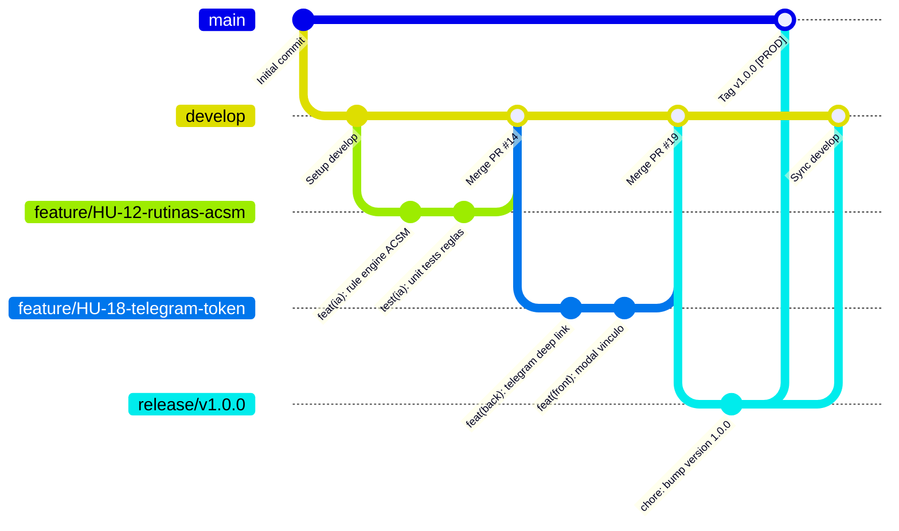
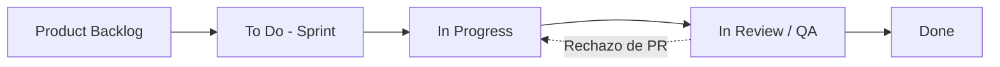
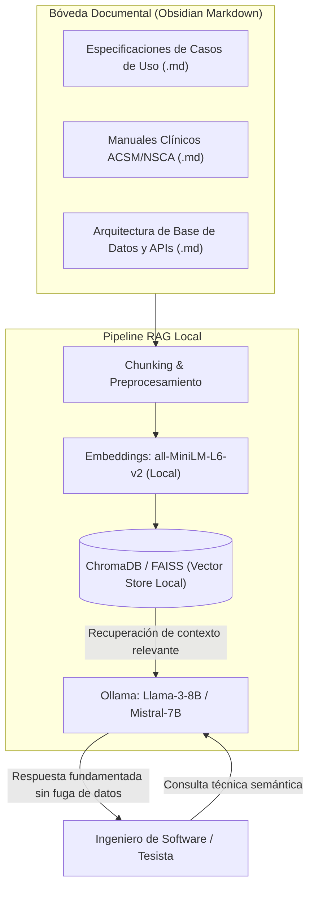
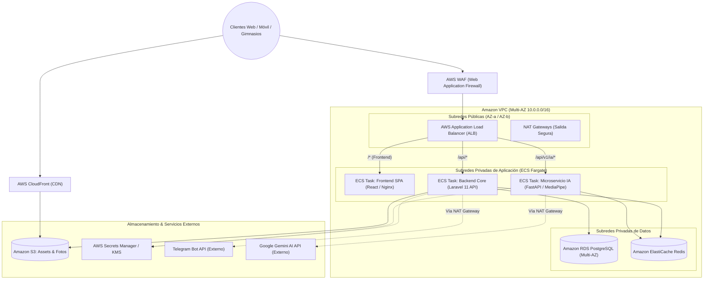

# Capítulo 6: Infraestructura para la Producción del Software

El establecimiento de una infraestructura de desarrollo, despliegue y producción resiliente, escalable y con alta disponibilidad constituye un pilar estratégico en la ingeniería de software moderna. En el marco del proyecto de grado **«Plataforma Web Integral de Gestión, Control de Acceso y Entrenamiento Inteligente para Gimnasios (DUBSS-GYM / FitGo!)»**, la arquitectura de infraestructura debe respaldar la gestión operativa del código fuente y la trazabilidad de requerimientos, asegurando simultáneamente:

1. **La ejecución transaccional y consistente del Backend Core (Laravel 11 / PHP 8.4)** encargado de membresías, facturación/pagos QR, control de accesos e integración de notificaciones asíncronas con Telegram Bot.
2. **El rendimiento y determinismo del Microservicio de Inteligencia Artificial (FastAPI / Python 3.12)**, el cual combina visión por computador para análisis postural con MediaPipe Pose, un motor de reglas determinista basado en normativas de la ACSM (*American College of Sports Medicine*) y la NSCA (*National Strength and Conditioning Association*) para prescripción de rutinas, y orquestación con Google Gemini para planificación nutricional.
3. **La sincronización visual de alta velocidad con la aplicación SPA en React 19**, construida con Vite, TypeScript, Tailwind CSS y arquitectura de estado reactivo (TanStack Query y Zustand).
4. **La alta disponibilidad y aislamiento perimetral** en la nube de Amazon Web Services (AWS) para soportar picos concurrentes de acceso físico, pagos y consultas de entrenamiento en gimnasios de Santa Cruz de la Sierra y el territorio nacional.

---

## 6.1. Gestión de Configuración de Software (SCM) y Estándar IEEE 828-2012

La Gestión de Configuración de Software (*Software Configuration Management* - SCM) se estructura rigurosamente bajo los lineamientos del estándar internacional **IEEE 828-2012** (*Standard for Configuration Management in Systems and Software Engineering*). Este plan formaliza la identificación, control de versiones, auditoría y trazabilidad de todos los elementos de configuración a lo largo del Ciclo de Vida del Software (SDLC).

### Identificación de Elementos de Configuración (*Software Configuration Items* - SCI):

* **SCI-01 (Código Fuente Application Core - Backend Laravel):** Código fuente de la API RESTful central en PHP 8.4 / Laravel 11 (`gimnasio-back`), controladores de negocio, servicios de membresías, autenticación de usuarios, middlewares de autorización RBAC y proveedores de integración (Telegram Bot, pasarelas QR).
* **SCI-02 (Código Fuente Microservicio de IA y Visión Computacional):** Repositorio del microservicio en Python 3.12 / FastAPI (`gimnasio-ia`), algoritmos de procesamiento de imagen/video mediante MediaPipe Pose, motor experto de inferencia de rutinas (reglas deterministas ACSM/NSCA) y conectores con el SDK de Google Gemini.
* **SCI-03 (Código Fuente Frontend SPA):** Código del cliente web en React 19 / TypeScript (`gimnasio-front`), módulos de características (*features*), sistema de diseño corporativo (*Enterprise Design System*), visualizadores de rutinas interactivas, interfaces de escaneo QR y dashboards administrativos con Apache ECharts.
* **SCI-04 (Artefactos de Base de Datos y Persistencia):** Migraciones de base de datos de Eloquent ORM, definiciones DDL/DML, *seeders* de catálogo deportivo (dataset estructurado de más de 800 ejercicios categorizados con esquemas JSON) y scripts de indexación en PostgreSQL 16.
* **SCI-05 (Infraestructura como Código - IaC y Contenedores):** Especificaciones *multi-stage* de Dockerfiles para cada subsistema, orquestaciones locales de Docker Compose, manifiestos de *Task Definitions* para AWS ECS Fargate y plantillas declarativas de aprovisionamiento de red VPC y CloudFormation/Terraform.
* **SCI-06 (Documentación Técnica y Modelos Upper CASE):** Modelos UML de análisis y diseño en Enterprise Architect (`.EAPX` / `.QEA`), especificaciones OpenAPI/Swagger generadas por FastAPI y Laravel, manuales de usuario y la bóveda documental técnica interconectada en Obsidian Markdown.

### Líneas Base (*Baselines*) y Control de Cambios:

Se definen tres líneas base formales durante el ciclo evolutivo:

1. **Functional Baseline (FBL):** Fijada al concluir la fase de análisis de requerimientos del sistema de gimnasios, con la aprobación formal del *Product Backlog*, los diagramas de casos de uso y la matriz de requerimientos funcionales (RF) y no funcionales (RNF).
2. **Development Baseline (DBL):** Establecida al cierre de cada Sprint tras la ejecución exitosa de pruebas unitarias y de integración en Laravel (`phpunit` / `pest`), tests del motor de reglas en Python (`pytest`) y validaciones de tipos en TypeScript (`tsc -b`).
3. **Release Baseline (RBL):** Versión congelada y etiquetada criptográficamente en la rama `main`, lista para despliegue automatizado en entornos de *Staging* y Producción Cloud.

Cualquier modificación sobre una línea base aprobada exige la autorización del **Comité de Control de Cambios (CCB)**, conformado por el *Product Owner* (representante del cliente/gimnasio) y el *Lead Architect*.

---

## 6.2. Control de Versiones Distribuido (Git) y Estrategia de Ramificación GitFlow

El repositorio se gestiona mediante Git bajo un modelo distribuido alojado en GitHub. Para sincronizar el desarrollo concurrente entre los tres componentes desacoplados (Frontend, Backend Laravel e Inteligencia Artificial), se implementa una adaptación estricta de la metodología **GitFlow**.



### Estructura Jerárquica de Ramas:

* **`main` (Producción):** Representa el código en estado de producción estable. Solo recibe fusiones probadas provenientes de `release/*` o parches urgentes de `hotfix/*`. Cada *merge* genera un Tag bajo Versionamiento Semántico (ej. `v1.0.0`).
* **`develop` (Integración):** Rama central de trabajo colaborativo. Agrupa las funcionalidades culminadas durante el Sprint tras superar los controles de calidad continuos.
* **`feature/*` (Nuevas Funcionalidades):** Ramas temporales creadas desde `develop` para abordar Historias de Usuario específicas (ej. `feature/HU-12-rutinas-acsm`, `feature/HU-18-telegram-token`, `feature/HU-09-analisis-pose`).
* **`release/*` (Estabilización y Despliegue):** Creadas a partir de `develop` para la estabilización final previa a un despliegue mayor; permiten ajustes menores de configuración, pruebas de carga y generación de notas de versión.
* **`hotfix/*` (Parches Críticos de Emergencia):** Creadas directamente desde `main` para solventar fallas graves en producción (ej. bugs en la pasarela de pagos QR o fallas en el registro de acceso). Se fusionan de inmediato tanto a `main` como a `develop`.

### Estándar de Conventional Commits v1.0.0:

Todos los mensajes de confirmación deben cumplir la siguiente sintaxis obligatoria:

$$\text{<tipo>(<alcance>): <descripción imperativa corta> [\#ID\_HU\_Jira]}$$

* **Tipos autorizados:** `feat` (funcionalidad nueva), `fix` (corrección de error), `refactor` (reestructuración de código sin alterar comportamiento externo), `test` (pruebas automatizadas), `docs` (documentación técnica), `perf` (optimización de rendimiento) y `chore` (tareas de infraestructura o configuración).
* **Ejemplos aplicados:**
  * `feat(ia): incorporar motor de reglas ACSM para prescripcion [#DUBSS-45]`
  * `feat(front): modal interactivo de vinculacion con Telegram Bot [#DUBSS-52]`
  * `fix(back): corregir validacion de vigencia de membresia en control de acceso [#DUBSS-61]`

---

## 6.3. Gestión Ágil del Proyecto con Jira Software Cloud y Trello

La gobernanza ágil del ciclo de desarrollo se ejecuta mediante **Jira Software Cloud** como herramienta CASE de administración y seguimiento de Sprints (metodología Scrum/Kanban), complementada con tableros de alto nivel en **Trello** para la comunicación ejecutiva y validación visual de los administradores del gimnasio.

### Flujo de Trabajo (*Workflow*) Personalizado en Jira:

$$\text{[ Product Backlog ]} \longrightarrow \text{[ To Do (Sprint) ]} \longrightarrow \text{[ In Progress ]} \longrightarrow \text{[ In Review / QA ]} \longrightarrow \text{[ Done ]}$$



### Reglas de Automatización Integradas (Jira-GitHub Automation):

* **Transición a *In Progress*:** Al crearse una rama `feature/*` que incluya en su nombre la clave del ticket (ej. `DUBSS-45`), la tarjeta en Jira avanza automáticamente a "In Progress".
* **Transición a *In Review / QA*:** Al abrirse un *Pull Request* hacia la rama `develop`, la tarjeta se traslada a "In Review / QA", asignando la tarea al revisor técnico y ejecutando los linters de código.
* **Transición a *Done*:** Al completarse la fusión (*merge*) del Pull Request con todas las comprobaciones de integración continua en verde, la tarea pasa a "Done", calculando de manera automática el *Lead Time* y el *Cycle Time* del equipo.

---

## 6.4. Sistema Híbrido de Gestión Documental (Obsidian Markdown + RAG Local)

A fin de centralizar la base de conocimiento y preservar la privacidad de las decisiones de diseño arquitectónico y de negocio, se implementa una solución de **Gestión del Conocimiento Híbrida**. Esta integra una bóveda de documentación interconectada en **Obsidian Markdown** con una canalización local de **Generación Aumentada por Recuperación (RAG)**.



### Componentes de la Arquitectura RAG Local:

* **Almacenamiento Vectorial Local (*Local Vector Store*):** Despliegue embebido de **ChromaDB / FAISS** que indexa vectorialmente los documentos técnicos de la bóveda (arquitectura de base de datos, directrices del Enterprise Design System, directivas de periodización de entrenamiento y endpoints).
* **Modelo de Embeddings Fuera de Línea:** Empleo del modelo de lenguaje denso **all-MiniLM-L6-v2**, generando representaciones vectoriales de 384 dimensiones sin requerir conectividad externa.
* **Orquestación de Lenguaje Local (*Local SLM*):** Servidor **Ollama** ejecutando los modelos **Llama-3-8B** o **Mistral-7B-Instruct** en hardware local. Permite consultar especificaciones de diseño, reglas de inferencia y diagramas de estado sin transferir información sensible a APIs comerciales de terceros.

---

## 6.5. Contenerización Avanzada con Docker y Multi-Stage Build Pipelines

Para asegurar una absoluta paridad entre los entornos de desarrollo, pruebas y producción (*Environment Parity*), cada uno de los tres componentes de la plataforma DUBSS-GYM se conteneriza mediante especificaciones Docker con construcción multietapa (*Multi-Stage Builds*). Esta técnica reduce sustancialmente el peso de las imágenes finales, elimina dependencias de compilación y minimiza vulnerabilidades de seguridad (*Attack Surface Reduction*).

### 6.5.1. Multi-Stage Dockerfile para el Backend Core (PHP 8.4 / Laravel 11 / Nginx + PHP-FPM):

```dockerfile
# ==========================================
# Stage 1: Dependency Installation & Optimizations
# ==========================================
FROM composer:2.7 AS vendor
WORKDIR /app
COPY composer.json composer.lock ./
RUN composer install \
    --no-dev \
    --no-interaction \
    --prefer-dist \
    --optimize-autoloader \
    --ignore-platform-reqs

# ==========================================
# Stage 2: Final Minimal Runtime Image
# ==========================================
FROM php:8.4-fpm-alpine AS runner
WORKDIR /var/www/html

# Instalación de extensiones de sistema y PostgreSQL/Redis
RUN apk add --no-cache \
    postgresql-dev \
    libzip-dev \
    zip \
    unzip \
    curl \
    fcgi \
    && docker-php-ext-install pdo pdo_pgsql zip pcntl bcmath \
    && pecl install redis \
    && docker-php-ext-enable redis \
    && rm -rf /tmp/pear

# Copia de dependencias de Composer y código fuente
COPY --from=vendor /app/vendor /var/www/html/vendor
COPY . /var/www/html

# Configuración de usuario no privilegiado para seguridad
RUN addgroup -g 1001 appgroup && \
    adduser -u 1001 -G appgroup -s /bin/sh -D appuser && \
    chown -R appuser:appgroup /var/www/html/storage /var/www/html/bootstrap/cache

USER appuser
EXPOSE 9000

HEALTHCHECK --interval=30s --timeout=5s --start-period=10s --retries=3 \
  CMD SCRIPT_NAME=/ping SCRIPT_FILENAME=/ping REQUEST_METHOD=GET cgi-fcgi -bind -connect 127.0.0.1:9000 || exit 1

CMD ["php-fpm"]
```

### 6.5.2. Multi-Stage Dockerfile para el Frontend (React 19 / TypeScript / Vite / Nginx):

```dockerfile
# ==========================================
# Stage 1: Node.js Compilation & Bundling
# ==========================================
FROM node:20-alpine AS builder
WORKDIR /app
COPY package.json package-lock.json ./
RUN npm ci --silent
COPY . .
RUN npm run build

# ==========================================
# Stage 2: High-Performance Production Nginx Server
# ==========================================
FROM nginx:1.27-alpine AS runner
COPY --from=builder /app/dist /usr/share/nginx/html
COPY nginx.conf /etc/nginx/conf.d/default.conf

# Configuración de compresión Gzip y fallback SPA
RUN chown -R nginx:nginx /usr/share/nginx/html && \
    chown -R nginx:nginx /var/cache/nginx && \
    touch /var/run/nginx.pid && \
    chown -R nginx:nginx /var/run/nginx.pid

USER nginx
EXPOSE 80

HEALTHCHECK --interval=30s --timeout=5s --start-period=5s --retries=3 \
  CMD curl -f http://localhost:80/ || exit 1

CMD ["nginx", "-g", "daemon off;"]
```

### 6.5.3. Multi-Stage Dockerfile para el Microservicio de IA (Python 3.12 / FastAPI / MediaPipe):

```dockerfile
# ==========================================
# Stage 1: Build Wheels & Compile C Extensions
# ==========================================
FROM python:3.12-slim AS builder
WORKDIR /app
ENV PYTHONDONTWRITEBYTECODE=1 \
    PYTHONUNBUFFERED=1

RUN apt-get update && apt-get install -y --no-install-recommends \
    build-essential \
    && rm -rf /var/lib/apt/lists/*

COPY requirements.txt .
RUN pip install --no-cache-dir --user -r requirements.txt

# ==========================================
# Stage 2: Final Runtime Image (Vision & Rules Engine)
# ==========================================
FROM python:3.12-slim AS runner
WORKDIR /app
ENV PYTHONDONTWRITEBYTECODE=1 \
    PYTHONUNBUFFERED=1 \
    PATH=/home/appuser/.local/bin:$PATH

# Librerías mínimas requeridas por OpenCV y MediaPipe
RUN apt-get update && apt-get install -y --no-install-recommends \
    libgl1 \
    libglib2.0-0 \
    curl \
    && rm -rf /var/lib/apt/lists/*

RUN useradd -u 1001 -m -s /bin/sh appuser
COPY --from=builder /root/.local /home/appuser/.local
COPY --chown=appuser:appuser . .

USER appuser
EXPOSE 8001

HEALTHCHECK --interval=30s --timeout=5s --start-period=10s --retries=3 \
  CMD curl -f http://localhost:8001/health || exit 1

CMD ["uvicorn", "app.main:app", "--host", "0.0.0.0", "--port", "8001", "--workers", "2"]
```

---

## 6.6. Arquitectura de Infraestructura Cloud en Amazon Web Services (AWS)

La plataforma DUBSS-GYM se despliega en la nube de **Amazon Web Services (AWS)** en la región `us-east-1` (N. Virginia), siguiendo las directrices de los cinco pilares del **AWS Well-Architected Framework**: Excelencia Operativa, Seguridad, Fiabilidad, Rendimiento Eficiente y Optimización de Costos.



### Componentes Principales de la Red y Cómputo:

* **Amazon Virtual Private Cloud (VPC):** Espacio de red virtual aislado segmentado en dos Zonas de Disponibilidad (Multi-AZ) con direccionamiento CIDR `10.0.0.0/16`. Cuenta con:
  * **Subredes Públicas:** Alojan el Balanceador de Carga (ALB) y dos NAT Gateways para proporcionar conectividad saliente segura.
  * **Subredes Privadas de Aplicación:** Alojan las tareas del orquestador de contenedores sin exposición directa a internet.
  * **Subredes Privadas de Datos:** Alojan las bases de datos relacionales y la caché en memoria, con acceso estrictamente restringido mediante listas de control de acceso a la red (NACLs).
* **AWS Application Load Balancer (ALB):** Punto de entrada único para el tráfico HTTPS, con terminación TLS 1.3 y enrutamiento por rutas (*Path-Based Routing*):
  * `/*` $\rightarrow$ Target Group del contenedor Frontend (React / Nginx).
  * `/api/v1/ia/*` $\rightarrow$ Target Group del Microservicio de IA (FastAPI).
  * `/api/*` $\rightarrow$ Target Group del Backend Core (Laravel 11).
* **Amazon Elastic Container Service (ECS) con AWS Fargate:** Plataforma de orquestación de contenedores *Serverless* que elimina la administración del sistema operativo base. Permite el auto-escalado horizontal de réplicas en función del consumo promedio de CPU ($>70\%$) o memoria.
* **Amazon Relational Database Service (RDS) for PostgreSQL:** Instancia relacional administrada con replicación síncrona en modo Multi-AZ, respaldos continuos (*Automated Backups* con retención de 14 días), almacenamiento SSD gp3 y cifrado nativo en reposo.
* **Amazon ElastiCache for Redis:** Clúster en memoria de alto rendimiento utilizado para la gestión centralizada de sesiones de usuario, el *rate limiting* contra ataques de fuerza bruta en los accesos al gimnasio, colas de trabajos asíncronos (*Laravel Queues*) y caché de catálogos deportivos.
* **Amazon Simple Storage Service (S3) + AWS CloudFront:** Almacenamiento perimetral para fotografías de comprobantes de pago, imágenes biomecánicas de ejercicios y certificados médicos, distribuido con baja latencia mediante la red global de CloudFront.

---

## 6.7. Seguridad, Cifrado y Protección Perimetral

La seguridad de la infraestructura se rige por el modelo de **Defensa en Profundidad (*Defense in Depth*)**, implementando salvaguardas en cada una de las capas de red, aplicación y datos:

### Mecanismos de Protección Implementados:

1. **AWS WAF (Web Application Firewall):** Inspección de paquetes HTTP/S en CloudFront y ALB para mitigar las vulnerabilidades del *OWASP Top 10* (Inyecciones SQL, *Cross-Site Scripting*, falsificación de peticiones). Incluye reglas automáticas de *Rate Limiting* (límite de 500 solicitudes por minuto por dirección IP) para mitigar intentos de denegación de servicio (DoS/DDoS).
2. **Grupos de Seguridad (*Security Groups*) y Aislamiento por Capas:**
   * **ALB SG:** Permite exclusivamente tráfico entrante en los puertos 80 (HTTP redirigido a 443) y 443 (HTTPS) desde `0.0.0.0/0`.
   * **ECS Frontend SG:** Acepta tráfico únicamente desde el ALB SG en el puerto 80.
   * **ECS Backend SG:** Acepta tráfico únicamente desde el ALB SG en el puerto 9000/8000.
   * **ECS IA Microservice SG:** Acepta tráfico exclusivamente desde el ALB SG en el puerto 8001.
   * **RDS SG:** Acepta únicamente conexiones en el puerto 5432 provenientes de los SGs del Backend Laravel.
   * **ElastiCache SG:** Acepta tráfico en el puerto 6379 proveniente de los SGs del Backend y Microservicio de IA.
3. **Cifrado de Datos en Tránsito y en Reposo:**
   * **En Tránsito:** Protocolo obligatorio **TLS 1.3** con certificados digitales gestionados por *AWS Certificate Manager (ACM)* para todas las transferencias cliente-servidor e interservicios.
   * **En Reposo:** Cifrado transparente en tablas RDS, clúster Redis y buckets S3 mediante **AWS Key Management Service (KMS)** con el algoritmo estándar **AES-256**.
4. **Gestión de Secretos y Políticas de Menor Privilegio (*Least Privilege*):** Integración con **AWS Secrets Manager** para el almacenamiento de variables críticas (claves de conexión a PostgreSQL, tokens del bot de Telegram, claves maestras JWT y la API Key de Google Gemini), rotándolas sin necesidad de desplegar nuevamente los contenedores. Los roles de ejecución en AWS IAM conceden únicamente permisos estrictos de lectura (*read-only*) sobre los recursos asignados.

---

## 6.8. Fórmulas de Estimación Financiera de Costos Cloud en AWS

El modelado financiero de la infraestructura de DUBSS-GYM se calcula a partir de la suma analítica de los costos mensuales directos de los recursos computacionales, persistencia, balanceo y ancho de banda.

### Ecuación General del Costo Total Mensual Cloud ($C_{Total}$):

$$C_{Total} = C_{ECS} + C_{RDS} + C_{ElastiCache} + C_{ALB} + C_{S3} + C_{DataTransfer} + C_{WAF}$$

### Desglose Formal por Componente:

#### 1. Costo de Cómputo en ECS Fargate ($C_{ECS}$):
Considerando las tareas activas para Frontend ($T_{front}$), Backend ($T_{back}$) e IA ($T_{ia}$):

$$C_{ECS} = \sum_{k \in \{front, back, ia\}} N_{tasks, k} \times \left[ \left( vCPU_k \times P_{vCPU} \right) + \left( RAM_k \times P_{GB} \right) \right] \times 730 \text{ h}$$

Donde $P_{vCPU} \approx \$0.04048 \text{ USD/vCPU-h}$ y $P_{GB} \approx \$0.004445 \text{ USD/GB-h}$ en la región `us-east-1`.

#### 2. Costo de Base de Datos Administrada RDS ($C_{RDS}$):

$$C_{RDS} = \left( 730 \text{ h} \times P_{instancia} \right) + \left( GB_{gp3} \times P_{gp3} \right) + \left( \text{IOPS}_{adicionales} \times P_{IOPS} \right)$$

#### 3. Costo del Balanceador de Carga ALB ($C_{ALB}$):

$$C_{ALB} = \left( 730 \text{ h} \times P_{ALB\_hora} \right) + \left( \text{LCU}_{consumidas} \times P_{LCU} \right)$$

Donde cada unidad LCU (*Load Balancer Capacity Unit*) evalúa de forma simultánea: nuevas conexiones por segundo, conexiones activas concurrentes y bytes transferidos.

---

### 6.8.1. Escenario A: Prototipo Académico / Carga Inicial (1 Gimnasio Piloto)

Orientado a la fase de validación de tesis y operación en un gimnasio piloto en Santa Cruz de la Sierra, con una afluencia de aproximadamente **100 a 300 usuarios y atletas activos concurrentes**.

| Componente | Especificación Técnica | Costo Mensual (USD) |
| :--- | :--- | :---: |
| **ECS Fargate (Frontend)** | 1 Tarea (0.25 vCPU, 0.5 GB RAM) | \$7.50 |
| **ECS Fargate (Backend Laravel)** | 1 Tarea (0.50 vCPU, 1.0 GB RAM) | \$15.00 |
| **ECS Fargate (Microservicio IA)** | 1 Tarea (0.50 vCPU, 1.0 GB RAM) | \$15.00 |
| **Amazon RDS PostgreSQL** | `db.t4g.micro` (Single-AZ, 20 GB SSD gp3) | \$17.80 |
| **Amazon ElastiCache Redis** | `cache.t4g.micro` (Single-AZ, 0.5 GB RAM) | \$12.50 |
| **AWS ALB + WAF Básico** | 730 horas de ALB + consumo base de reglas | \$22.00 |
| **S3 + CloudFront + Transferencia** | 10 GB almacenamiento + 50 GB transferencia | \$5.20 |
| **Total Mensual Estimado** | — | **\$95.00 USD** |

$$\text{Costo Total Escenario A} \approx \mathbf{\$95.00 \text{ USD/mes}} \quad (\approx \mathbf{661.20 \text{ Bs/mes}} \text{ al tipo de cambio oficial de } 6.96 \text{ Bs/USD})$$

---

### 6.8.2. Escenario B: Producción Comercial / Alta Demanda (Cadena Multi-Gimnasio)

Orientado a la comercialización y despliegue masivo como plataforma SaaS multi-inquilino (*Multi-Tenant*), soportando **entre 2,500 y 3,500 socios concurrentes** en horas pico de acceso físico y generación automatizada de rutinas e informes de progreso.

| Componente | Especificación Técnica | Costo Mensual (USD) |
| :--- | :--- | :---: |
| **ECS Fargate (Frontend)** | 2 Tareas auto-escalables (0.5 vCPU, 1 GB RAM) | \$30.00 |
| **ECS Fargate (Backend Laravel)** | 4 Tareas auto-escalables (1.0 vCPU, 2 GB RAM) | \$120.00 |
| **ECS Fargate (Microservicio IA)** | 4 Tareas auto-escalables (1.0 vCPU, 2 GB RAM) | \$120.00 |
| **Amazon RDS PostgreSQL** | `db.r6g.large` (Multi-AZ de alta disponibilidad, 100 GB gp3) | \$245.00 |
| **Amazon ElastiCache Redis** | `cache.r6g.large` (Clúster Multi-AZ de alta concurrencia) | \$115.00 |
| **AWS ALB + WAF Avanzado** | Reglas gerenciadas OWASP + 5 LCUs promedio | \$65.00 |
| **S3 + CloudFront + KMS + Datos** | 150 GB de medios y reportes + CDN global + Secrets Manager | \$45.00 |
| **Total Mensual Estimado** | — | **\$740.00 USD** |

$$\text{Costo Total Escenario B} \approx \mathbf{\$740.00 \text{ USD/mes}} \quad (\approx \mathbf{5,150.40 \text{ Bs/mes}} \text{ al tipo de cambio oficial de } 6.96 \text{ Bs/USD})$$

