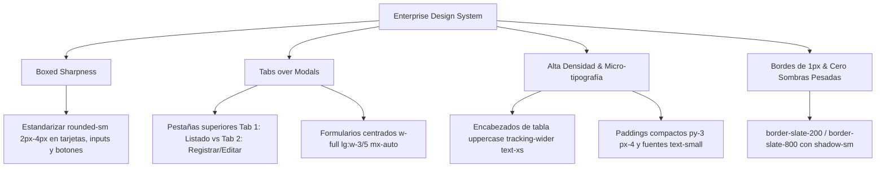

# Plan de Implementación: Adopción Integral del Enterprise Design System

Este documento establece la propuesta técnica y la estrategia de refactorización visual para aplicar el **Enterprise Design System** a toda la plataforma interna (excluyendo la Landing Page), alineando la experiencia a estándares corporativos de alta densidad, nitidez estructural (*boxed sharpness* con `rounded-sm`), navegación por pestañas en módulos CRUD y micro-tipografía.

---

## 1. Alcance y Exclusiones

* **Áreas Incluidas (100% de la plataforma interna)**:
  1. **Layout Principal**: [DashboardLayout.tsx](file:///c:/Users/brayan/Documents/Chamba/Taller%20de%20grado/DUBSS-GYM/gimnasio-front/src/layouts/DashboardLayout.tsx) (Sidebar, barra superior, breadcrumbs y contenedor).
  2. **Gestión de Usuarios**: [features/users/](file:///c:/Users/brayan/Documents/Chamba/Taller%20de%20grado/DUBSS-GYM/gimnasio-front/src/features/users/) (`UserListPage`, `UserTable`, `UserFilters`, formularios).
  3. **Inventario y Espacios**: [features/inventario/](file:///c:/Users/brayan/Documents/Chamba/Taller%20de%20grado/DUBSS-GYM/gimnasio-front/src/features/inventario/) (`AmbienteListPage`, `EquipoListPage`, tablas y formularios de catálogo).
  4. **Entrenamiento**: [features/entrenamiento/](file:///c:/Users/brayan/Documents/Chamba/Taller%20de%20grado/DUBSS-GYM/gimnasio-front/src/features/entrenamiento/) (`EjerciciosPage`, `RutinasPage`, `PlanesEntrenamientoPage`, tabs).
  5. **Trámites y Matrículas**: [features/tramites/](file:///c:/Users/brayan/Documents/Chamba/Taller%20de%20grado/DUBSS-GYM/gimnasio-front/src/features/tramites/) (`TramitesPage`, boletas y formularios).
  6. **Disciplinas y Horarios**: [features/disciplinas/](file:///c:/Users/brayan/Documents/Chamba/Taller%20de%20grado/DUBSS-GYM/gimnasio-front/src/features/disciplinas/) (`DisciplinasPage`).
  7. **Planes y Tarifas**: [features/planes/](file:///c:/Users/brayan/Documents/Chamba/Taller%20de%20grado/DUBSS-GYM/gimnasio-front/src/features/planes/) (`PlanesPage`).
  8. **Control de Accesos & Garita**: [features/accesos/](file:///c:/Users/brayan/Documents/Chamba/Taller%20de%20grado/DUBSS-GYM/gimnasio-front/src/features/accesos/) (`ControlAccesoPage`, `EscanerQRModal`).
* **Áreas Excluidas**:
  - **Landing Page**: [features/landing/](file:///c:/Users/brayan/Documents/Chamba/Taller%20de%20grado/DUBSS-GYM/gimnasio-front/src/features/landing/) (permanece con su estética pública actual intacta).

---

## 2. Principios de Diseño a Estandarizar

1. **Boxed Sharpness**:
   - Reemplazar radios excesivos (`rounded-xl`, `rounded-2xl`, `rounded-3xl`, `borderRadius: '12px'`) por `rounded-sm` (2px - 4px) en todas las tarjetas, contenedores de tablas, inputs, filtros y botones.
2. **Tabs sobre Modales para CRUD Complejo**:
   - Para módulos con formularios extensos (Usuarios, Ambientes, Equipos, Rutinas, Disciplinas), sustituir el botón modal flotante por la barra de navegación de pestañas superior:
     - `Tab 1: Listado de Registros`
     - `Tab 2: Registrar / Editar [Entidad]`
   - Al activar el formulario, centrar el panel a `w-full lg:w-3/5 mx-auto` con botón de cancelación para retornar inmediatamente a la pestaña de listado.
   - Reservar modales exclusivamente para confirmaciones de acción rápida (ej. confirmación de eliminación).
3. **Tablas de Alta Densidad**:
   - Encabezados: `bg-slate-50 dark:bg-dark-bg border-b border-slate-200 text-xs font-bold uppercase tracking-wider text-slate-600`.
   - Celdas: `py-3 px-4`, tamaño `text-small` (11px) / `0.85rem`, hover sutil `hover:bg-slate-50`.
   - Botones de acción: tamaño compacto con iconos vectoriales discretos (`FaEye`, `FaPenToSquare`, `FaTrashCan`) y colores con tintes sutiles.
4. **Paleta y Contrastes Institucionales**:
   - Botones primarios: `#0077D4` (hover `#0840A8`) o azul institucional `#003B70`.
   - Botones destructivos: `bg-rose-600 hover:bg-rose-700 text-white`.
   - Superficies: `bg-white` con borde `1px solid #E2E8F0` / `border-slate-200`.

---

## 3. Plan de Refactorización por Módulos (Fases)

### Fase 1: Tokens y Micro-Tipografía en Estilos Globales
* Configurar en [src/index.css](file:///c:/Users/brayan/Documents/Chamba/Taller%20de%20grado/DUBSS-GYM/gimnasio-front/src/index.css) los tokens corporativos del skill:
  - `--text-micro: 0.5625rem;` (~9px)
  - `--text-tiny: 0.625rem;` (~10px)
  - `--text-small: 0.6875rem;` (~11px)
  - Clases utilitarias de nitidez (`rounded-sm`, `border-enterprise`).

### Fase 2: Layout del Dashboard ([DashboardLayout.tsx](file:///c:/Users/brayan/Documents/Chamba/Taller%20de%20grado/DUBSS-GYM/gimnasio-front/src/layouts/DashboardLayout.tsx))
* Homogeneizar el Sidebar y Header:
  - Remover sombras flotantes excesivas en la barra de navegación.
  - Estandarizar bordes de 1px y enlaces activos con acento vertical definido (`border-l-2`).
  - Breadcrumbs y badges de usuario con tipografía micro-enterprise (`text-tiny font-bold uppercase tracking-wider`).

### Fase 3: Módulo de Usuarios ([features/users/](file:///c:/Users/brayan/Documents/Chamba/Taller%20de%20grado/DUBSS-GYM/gimnasio-front/src/features/users/))
* [UserListPage.tsx](file:///c:/Users/brayan/Documents/Chamba/Taller%20de%20grado/DUBSS-GYM/gimnasio-front/src/features/users/pages/UserListPage.tsx):
  - Implementar arquitectura de tabs superiores: `[ Directorio de Usuarios ]` vs `[ + Registrar Usuario ]` (solo administradores/recepcionistas).
  - Al editar o crear, renderizar el panel centrado (`w-full lg:w-3/5 mx-auto`) de [UserFormModal.tsx](file:///c:/Users/brayan/Documents/Chamba/Taller%20de%20grado/DUBSS-GYM/gimnasio-front/src/features/users/components/UserFormModal.tsx) integrado directamente en la pestaña del formulario.
* [UserTable.tsx](file:///c:/Users/brayan/Documents/Chamba/Taller%20de%20grado/DUBSS-GYM/gimnasio-front/src/features/users/components/UserTable.tsx):
  - Encabezados uppercase nítidos, borde `rounded-sm`, botones de acción compactos con micro-paddings.

### Fase 4: Módulo de Inventario y Ambientes ([features/inventario/](file:///c:/Users/brayan/Documents/Chamba/Taller%20de%20grado/DUBSS-GYM/gimnasio-front/src/features/inventario/))
* [AmbienteListPage.tsx](file:///c:/Users/brayan/Documents/Chamba/Taller%20de%20grado/DUBSS-GYM/gimnasio-front/src/features/inventario/pages/AmbienteListPage.tsx):
  - Migrar a tabs: `[ Ambientes & Salas ]` vs `[ + Registrar Ambiente ]`. Formulario centrado con nitidez `rounded-sm`.
* [EquipoListPage.tsx](file:///c:/Users/brayan/Documents/Chamba/Taller%20de%20grado/DUBSS-GYM/gimnasio-front/src/features/inventario/pages/EquipoListPage.tsx):
  - Estructurar selector de pestañas limpio con borde inferior: `[ Equipos ]`, `[ Categorías / Tipos ]`, `[ Marcas ]` y tab contextual `[ + Registrar ]`.
  - [EquipoTable.tsx](file:///c:/Users/brayan/Documents/Chamba/Taller%20de%20grado/DUBSS-GYM/gimnasio-front/src/features/inventario/components/EquipoTable.tsx), [TipoEquipoTable.tsx](file:///c:/Users/brayan/Documents/Chamba/Taller%20de%20grado/DUBSS-GYM/gimnasio-front/src/features/inventario/components/TipoEquipoTable.tsx), [MarcaTable.tsx](file:///c:/Users/brayan/Documents/Chamba/Taller%20de%20grado/DUBSS-GYM/gimnasio-front/src/features/inventario/components/MarcaTable.tsx): tablas de alta densidad con `rounded-sm` y toolbar de búsqueda unificada.

### Fase 5: Módulo de Entrenamiento ([features/entrenamiento/](file:///c:/Users/brayan/Documents/Chamba/Taller%20de%20grado/DUBSS-GYM/gimnasio-front/src/features/entrenamiento/))
* [EjerciciosPage.tsx](file:///c:/Users/brayan/Documents/Chamba/Taller%20de%20grado/DUBSS-GYM/gimnasio-front/src/features/entrenamiento/pages/EjerciciosPage.tsx), [RutinasPage.tsx](file:///c:/Users/brayan/Documents/Chamba/Taller%20de%20grado/DUBSS-GYM/gimnasio-front/src/features/entrenamiento/pages/RutinasPage.tsx) y [PlanesEntrenamientoPage.tsx](file:///c:/Users/brayan/Documents/Chamba/Taller%20de%20grado/DUBSS-GYM/gimnasio-front/src/features/entrenamiento/pages/PlanesEntrenamientoPage.tsx):
  - Reemplazar botones redondeados flotantes y headers con gradientes pesados por tabs sobrios con borde inferior (`border-b border-slate-200`).
  - Estandarizar tablas de catálogo con encabezados uppercase y cards compactas en vista mobile.

### Fase 6: Trámites, Planes, Disciplinas y Control de Accesos
* [TramitesPage.tsx](file:///c:/Users/brayan/Documents/Chamba/Taller%20de%20grado/DUBSS-GYM/gimnasio-front/src/features/tramites/pages/TramitesPage.tsx):
  - Barra de filtrado sobria con `rounded-sm`, badges de estado nítidos sin efectos de brillo excesivos.
* [DisciplinasPage.tsx](file:///c:/Users/brayan/Documents/Chamba/Taller%20de%20grado/DUBSS-GYM/gimnasio-front/src/features/disciplinas/pages/DisciplinasPage.tsx) y [PlanesPage.tsx](file:///c:/Users/brayan/Documents/Chamba/Taller%20de%20grado/DUBSS-GYM/gimnasio-front/src/features/planes/pages/PlanesPage.tsx):
  - Tarjetas de planes y disciplinas con bordes de 1px definidos (`rounded-sm`), sin `rounded-2xl` ni sombras gigantes.
* [ControlAccesoPage.tsx](file:///c:/Users/brayan/Documents/Chamba/Taller%20de%20grado/DUBSS-GYM/gimnasio-front/src/features/accesos/pages/ControlAccesoPage.tsx):
  - Modal del lector QR con contenedor centrado enterprise y bordes limpios.

---

## 4. Plan de Verificación

| Verificación | Método | Criterio de Éxito |
| :--- | :--- | :--- |
| **1. Landing Page Intacta** | Revisión de archivos y rutas en `/` | `src/features/landing/` sin modificaciones de estructura ni estilos. |
| **2. Coherencia Visual Enterprise** | Inspección en módulos internos | Todas las tarjetas, inputs, tablas y botones usan `rounded-sm`, bordes de 1px y micro-tipografía. |
| **3. Flujo Tabs sobre Modales** | Navegación en CRUDs | Al pulsar "Registrar/Editar" se pasa a pestaña con formulario centrado (`w-full lg:w-3/5 mx-auto`) con botón "Cancelar y Volver". |
| **4. Compilación TypeScript** | `cmd.exe /c "npx tsc --noEmit"` | 0 errores de tipado en todo `gimnasio-front`. |
| **5. Build de Producción** | `cmd.exe /c "npm run build"` | Compilación exitosa de Vite. |

---

## 5. Preguntas Abiertas

> [!NOTE]
> 1. En los módulos CRUD (Usuarios, Ambientes, Equipos), ¿prefieres que el formulario de creación/edición reemplace al modal abriéndose en una pestaña integrada (`Tab 2: Registrar / Editar`), o deseas que algunos formularios rápidos mantengan modal compacto con estética `rounded-sm`? (La recomendación Enterprise es pestaña integrada para formularios con más de 3 campos).
